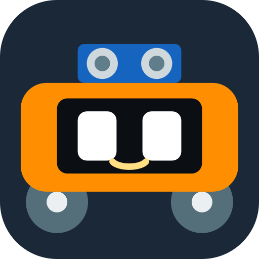

# Robot Car app (Android)

A remote for this car that looks and feels like a game controller, played sideways (landscape):
a **thumbstick** on the left (or **tilt driving**), four chunky **face buttons** on the right, and a
little green **screen** in the middle that shows what the car is doing and which **song** it dances to.
Under the screen: **Moves**, **Play** and a live **Radar** page. Every button is a real-feeling
button: it sinks when you press it and the phone clicks.
Your phone buzzes when guard mode sees an intruder or when the car's battery is nearly empty.
A **real game controller** works too (see below).

## Download

**[⬇ Download RobotCar.apk](https://github.com/mayaanmalik2486/robot-car/raw/main/App/RobotCar.apk)** (53 KB, version 3.1)

Send this link to anyone - they can download it straight onto their phone:
`https://github.com/mayaanmalik2486/robot-car/raw/main/App/RobotCar.apk`
(The app also has a **Share app** button in ❔ help that sends the link.)
Already have an older version? Just install this one over it.

Works on **Android phones** (Android 5 and newer). It does **not** work on iPhones: Apple doesn't
let apps talk to HC-05-type Bluetooth modules.

**Radar** and the **song name** need the car to run the newest program (Robot_Car_Main or a song
file from Dances, October 20 2026 or later). Everything else works with older car programs too.

## Install

1. Open the link on the phone and download `RobotCar.apk`. Chrome may warn that this kind of
   file can be harmful - tap **Download anyway** (it's this app, made for your car).
2. Tap the downloaded file. Android asks to allow installing apps from Chrome (or Files):
   tap **Settings**, switch **Allow from this source** on, go back, tap **Install**.
3. If **Play Protect** says it doesn't know the app: tap **More details > Install anyway**.
   (It's not on the Play Store, so Google hasn't scanned it.)

## First time

1. Switch the car on.
2. On the phone: **Settings > Bluetooth > pair new device > HC-05**. The PIN is **1234** (or **0000**).
3. Open **Robot Car**, tap **🔗 connect**, allow the Bluetooth permission, choose **HC-05**.
   Next time it connects by itself.

## The screen

| Where | What |
|---|---|
| Top | 🔗 connect / ⏏ disconnect · 🎵 the song this car dances to · 🎮 your controller (tap: its buttons) · ⚽ football · 🔊 sound · ❔ help |
| Left | 🐇/🐢 fast-slow · 📱 tilt on/off · the thumbstick |
| Middle | the car's screen (connected, what it's doing, the dance clock, mute / football / speed / battery), then the pages: 🕹 Moves · 🎮 Play · 📡 Radar |
| Right | 🛑 STOP and the face buttons: 💃 dance (yellow), ⚽ kick (blue), 📯 horn (red), 🚀 turbo (green) |

## The controls

| Control | Letter sent | What the car does |
|---|---|---|
| 🕹 stick up / down | F / B | forward / backward until you let go |
| 🕹 stick left / right | L / R | spin left / right |
| 🕹 stick up-left / up-right | G / H | curve left / right (forward while turning) |
| 📱 tilt (hold the pad) | the same letters | tip the phone away = forward, toward you = back, turn it like a steering wheel = steer. Let go = stop |
| 🛑 STOP | S | stops everything |
| 🐇 / 🐢 | W / Q | fast / slow |
| 🚀 turbo | T | a 1.5 s full-power burst |
| 📯 horn | Y | beep beeeep |
| ⚽ kick | k | shoots the ball now |
| 💃 dance | 4 | dance to the song (tap again ON a beat to line it up). The screen shows the song and a clock |
| Moves: 🔍 search / 😈 chaos | I / 1 | the self-driving modes |
| Moves: 🍩 donut / ↩️ 180° / 🅿️ brake | 3 / U / u | |
| Moves: ⏫ auto / ⏬ reverse | 2 / J | drives by itself, stops at obstacles |
| Play: 🚶 follow me | M | keeps about 25 cm from you |
| Play: 🥅 goalkeeper | K | saves the ball |
| Play: 🚨 guard | A | alarm: walk away during the 5 beeps |
| Play: 🎵 music | N | your hand plays notes |
| Play: ✋ gestures | E | tap, double tap, hold close, hold further |
| Play: 🐶 pet | P | a little robot pet |
| Radar: 📡 start the radar | O | the car stands still and sweeps its sensor; the page draws a dot for everything it sees (up to 1.5 m), the car's own screen draws it too |
| ⚽ football | V | the distance sensor off (it never stops for things) |
| 🔊 sound | X | mute / unmute |

Hold any mode button to see its name.

## Game controller (GameSir Cyclone 2, Xbox, PS, ...)

The controller can't talk to the car by itself (the HC-05 only understands phones and computers),
but it drives **through the phone**: connect the controller to the phone (Bluetooth, or its
USB dongle with a USB-C adapter), open the app, connect to the car. The 🎮 at the top shows it's
there (tap it for this list). On the Cyclone 2, use its Android / Xbox (X-input) mode.

It drives like a racing game:

| Controller | Does |
|---|---|
| **RT** | gas (forward) |
| **LT** | reverse |
| **left stick** | steer (with RT: curve left / right) - or drive with the stick alone |
| **A / B / X / Y** | turbo / STOP / kick / dance |
| **RB** | fast / slow |
| **L3** (click the left stick) / **R3** | horn / brake |
| **D-pad** ↑ → ↓ ← | search / chaos / donut / 180° turn |
| **START** | radar |
| **SELECT** | football (sensor off) |

**Hold LB** for the play modes:

| LB + | Does |
|---|---|
| A / B / X / Y | follow me / guard / goalkeeper / pet |
| D-pad ↑ / ↓ | music / gestures |
| D-pad → / ← | auto forward / auto backward |
| SELECT | sound on / off |

The button you press lights up on the screen, and the controller rumbles with the phone when guard
mode sees an intruder or the battery is low. The Cyclone 2's back buttons can copy any button
(set them in the GameSir app).

## Something doesn't work?

| What you see | Why, and the fix |
|---|---|
| The screen says **⚠ OLD CAR PROGRAM**; play modes, radar, horn or kick do nothing; the speed button won't go back to fast | The car runs an older program that doesn't know these (for example one from the old **Robot_Dances** folder or the v7.1 sketch). Upload **Robot_Car_Main** - or a song from the **Dances** folder - from `Documents\Arduino\robot-car` (this GitHub folder). |
| **(no radar: old program)** | The car's program is from before October 20, 2026. Upload the newest one (same as above). |
| Not sure what's going on | **Hold the green screen**: the link log shows every letter the app sent (->) and every line the car answered (<-). |

## What the car sends back

| Line | Means |
|---|---|
| `~MODE\|1010` | what it is doing, then 1/0 for muted, football, slow, low battery |
| `#S:Badtameez Dil` | the song it dances to (answer to `?`) |
| `#R:f42` | radar: direction `a` (50° right) ... `f` (ahead) ... `k` (50° left), distance in cm (999 = nothing) |

## For developers

- `source/` - the app (plain Java, no extra libraries) + `AndroidManifest.xml` + the icon.
  The code is in parts: `MainActivity` (the screen), `Car` (the letters), `CarLink` (Bluetooth),
  `CarState` (what the car says), `PadButton` (the buttons), `StickView`, `TiltDriver`, `Gamepad`, `RadarView`
- `tools/IconGen.java` - draws the icon
- `build-app.ps1` - builds and signs `RobotCar.apk` (needs Java 17 + the Android SDK; the signing key is kept
  outside GitHub, in `Documents\Arduino\robot-car-app-signing`)
