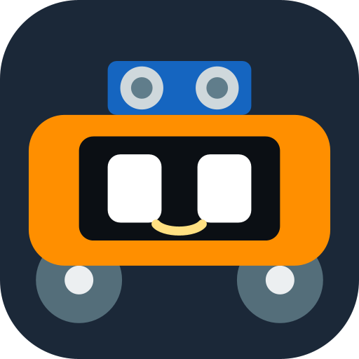
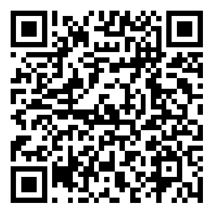

# Robot Car app (Android) - version 4.2



A remote for this car that looks and feels like a real game controller, held sideways:
**smooth RC-car steering**, one stick, **two sticks** or **tilt** driving, chunky keys that sink when you
press them, and the car's own little green **screen** in the middle. It is made for the
**GameSir Cyclone 2** (both sticks, both triggers, every button) and works with other controllers too.
Every button can be changed, and a live drawing of the controller shows what each one does.

There is also a **web version for computers**: [Web/README.md](../Web/README.md).

## Download

**[⬇ Download RobotCar.apk](https://github.com/mayaanmalik2486/robot-car/raw/main/App/RobotCar.apk)** (version 4.2)



Scan the QR code with a phone camera, or send this link to anyone:
`https://github.com/mayaanmalik2486/robot-car/raw/main/App/RobotCar.apk`
(The app's help has a **Share app** button that sends the link.)

**Already have the old app? Just install this one over it** - it is signed with the same key, so
Android updates it and keeps nothing broken. Older versions: [Old_APKs](Old_APKs).

Works on Android phones and tablets (Android 5 and newer), and on Chromebooks that run Android apps.
It does **not** work on iPhones: Apple doesn't let apps talk to HC-05-type Bluetooth modules.

## What's new in 4.2

- **HEAD: turn the car's sensor head yourself.** A new fourth page with a blue wheel, like the
  steering wheel: turn it and the car's "eyes" (the distance sensor on its servo) look left or right,
  up to 50 degrees each way, and stay there. **LOOK STRAIGHT** (or STOP) centres them. The 3D car's
  head turns too. On the controller: **hold LB and move the right stick**. It needs the newest car
  program (upload Robot_Car_Main or a song again).

## What was new in 4.1 (the new look)

- **A live 3D car** in the middle of the screen: its wheels spin, the floor rushes by and turns when
  you steer, it leans in bends, bounces when it dances, sweeps its sensor head in radar mode (with the
  dots it sees on the floor) and meets a red wall when it is blocked. Not connected yet? It still
  follows your controls, so you can try everything.
- **A real steering wheel and a throttle lever** ("WHEEL" driving, the new default): push the lever
  on the left up for forward and down for backward; grab the wheel on the right anywhere and turn it
  (126 degrees each way = full steering). Let go and both spring back.
- **Glossy 3D bubble buttons** in bright colours, with a ripple and a springy press; the mode buttons
  carry a little picture bubble; the tabs have a sliding orange pill; everything rises into place.
- **A night-sky background** with slow bubbles, big condensed letters, and one orange accent.
- 1 stick and tilt are still there (tap **WHEEL** at the top to switch).

## What was new in 4.0

- **Real steering.** With the newest car program, the app sets the speed of each side of the car
  itself, like a real RC car: push a little = slowly, all the way = full speed; steer a little =
  a wide bend, more = tighter, all the way with no throttle = spin on the spot. It steers backward too.
  Older car programs still work (with the 6 driving letters).
- **The GameSir Cyclone 2, mapped properly:** left stick = throttle, right stick = steering, every
  button with a job (table below), and **every job can be changed**.
- **The controller screen:** a drawing of the Cyclone 2 that lights up live as you press anything,
  with the stick and trigger values - tap any button to give it another job.
- **Settings:** one stick / two sticks / tilt, steering feel, dead zones, haptics, the little
  controller badges on the buttons, reset.
- **A new look:** dark graphite with one orange accent, condensed game-style letters, and a screen
  that re-arranges itself for any phone, tablet or window size.
- **Safer:** the car stops by itself if the phone goes out of range (it hears nothing for 0.6 s);
  STOP also stops a mode the car would protect; "connection lost" offers to reconnect; a controller
  unplugged while driving stops the car; back must be pressed twice to close the app.
- **The car got better too** (upload the new Robot_Car_Main or a song): slow / fast now works at
  once while reversing or spinning, the smooth brake keeps a curve a curve, and the car reads every
  letter that is waiting instead of one per loop.

## Install

1. Open the link on the phone and download `RobotCar.apk`. Chrome may warn that this kind of
   file can be harmful - tap **Download anyway** (it's this app, made for your car).
2. Tap the downloaded file. Android asks to allow installing apps from Chrome (or Files):
   tap **Settings**, switch **Allow from this source** on, go back, tap **Install** (or **Update**).
3. If **Play Protect** says it doesn't know the app: tap **More details > Install anyway**.
   (It's not on the Play Store, so Google hasn't scanned it.)

## First time

1. Upload the newest car program (**Robot_Car_Main**, or any song from **Dances**) - for the smooth steering.
2. Switch the car on.
3. On the phone: **Settings > Bluetooth > pair new device > HC-05**. The PIN is **1234** (or **0000**).
4. Open **Robot Car**, tap **Connect**, allow the "Nearby devices" permission, choose **HC-05**.
   Next time it connects by itself.

## The screen

```
 [Connect]  ♪ Robot Groove ........  [controller] [FAST] [WHEEL] [⚙] [?]
 +----------+  +---------------------------+  +----------+
 |   GAS    |  | ● CONNECTED · STEERING    |  |          |
 |   ║      |  |      (the 3D car)         |  | steering |
 | [lever]  |  | DRIVE 82%                 |  |  wheel   |
 |   ║      |  +---------------------------+  |          |
 |   REV    |  (STOP) (Dance)(Kick)(Horn)(Turbo)         |
 |          |  [ MOVES ] [ PLAY ] [ RADAR ]   |          |
 | THROTTLE |  [ the page's buttons ...   ]   |  STEER   |
 +----------+                                 +----------+
```

| Where | What |
|---|---|
| Top | **Connect** (shows the car when connected; tap again to disconnect) · the song this car dances to · your **controller** (tap: the controller screen) · **FAST / SLOW** · **1 STICK / 2 STICKS / TILT** (tap to switch) · **⚙ settings** · **? help** |
| Left | the **throttle lever** (or the stick, with 1 stick / tilt) |
| Middle | the live **3D car** with the car's status written over it, **STOP** and the action bubbles, then the pages: **Moves**, **Play**, **Radar** |
| Right | the **steering wheel** (with 1 stick / tilt: STOP and the four action bubbles) |

The 3D picture shows: connected or not, and whether the car is **steering** or using **letters**
(an older program) · what the car is doing (with a dance clock and the song while dancing, the nearest
thing while the radar runs, the speed while driving) · sound, sensor, speed and battery. With
steering, two bars at its sides show how fast each side of the car turns. **Hold the 3D picture**
for the link log. The button of the mode that is running lights up orange.

With a controller connected, every button shows a small **badge** with the controller button that
does the same job (A, RT, LB+A, ▲ ...). Switch them off in Settings.

## The controls

| Control | What the car does |
|---|---|
| **1 STICK** | push where you want to go: up = forward, down = backward, sideways = spin, in between = a bend. A little = slowly, all the way = full speed. Let go = stop |
| **WHEEL** | the lever on the left = throttle (up = forward, down = backward, a little = slowly); the steering wheel on the right = steering (grab it anywhere and turn). Wheel with no throttle = spin on the spot. Let go = both spring back, the car stops |
| **TILT** | hold the round pad and tilt the phone like a steering wheel (tip it away = forward). Let go = stop |
| **FAST / SLOW** | the top speed (also for the car's own modes: auto, chaos, donut ...) |
| **STOP** | stops everything, also a running mode |
| Dance / Kick / Horn / Turbo | dance (tap again ON a beat to line it up) / shoot the ball / beep beeeep / 1.5 s full power |
| **Moves** | search · chaos · donut · 180° · auto (forward, stops at walls) · reverse · smooth brake · horn |
| **Play** | follow me · goalkeeper · guard (alarm) · music (your hand plays notes) · gestures · pet |
| **Radar** | the car stands still and sweeps its sensor; the page draws a dot for everything it sees (up to 1.5 m) |
| **Head** | turn the blue wheel: the sensor head looks left or right (5 degrees a step, up to 50) and stays there. **LOOK STRAIGHT** centres it |

When a mode is running (a dance, search ...), the sticks leave it alone until you let them go and
push again, or move them clearly - so a thumb resting on a stick can't stop it by accident.

## The GameSir Cyclone 2

The controller can't talk to the car by itself (the HC-05 only talks to phones and computers):
it connects to the **phone**, and the app passes everything on.

**Connect it:**
- **By Bluetooth (Android mode):** hold **HOME + A** for 2 seconds until the Home light flashes
  **yellow**, then pick **GameSir-Cyclone 2** in the phone's Bluetooth list.
- **With its 2.4 GHz dongle:** plug the dongle into the phone with a USB-C adapter (light **green**,
  XInput mode).
- Its other modes work too: **blue** (PlayStation style) and **red** (Switch - the triggers are then
  only on / off).
- Won't pair? Hold **HOME + SHARE** for 2 seconds to start pairing again.

| Button | Job |
|---|---|
| **Left stick** up / down | **Throttle**: forward / backward - the further you push, the faster it goes (31 steps) |
| **Right stick** left / right | **Steering**: with throttle = a bend (backward too), without = spin on the spot |
| **RT** | Turbo (pull past 60 %; let it back under 30 % to use it again) |
| **LT** | Smooth brake |
| **A** | Dance (press on the first beat; again ON a beat to line it up) |
| **B** | **STOP** everything |
| **X** | Kick |
| **Y** | Horn |
| **RB** | Football mode (distance sensor off / on) |
| **LB** | **SHIFT** - hold it for the second jobs below |
| **D-pad** ▲ ▶ ▼ ◀ | Search / chaos / donut / 180° turn |
| **START** (≡) | Radar (and the app shows the Radar page; press again to stop it) |
| **SELECT** (⧉) | Mute / sound on |
| **L3 / R3** (click the sticks) | Auto forward / auto backward |
| **HOME** | Android's (not used by the app) |

| Hold LB + | Job |
|---|---|
| **A / B / X / Y** | Follow me / guard / goalkeeper / pet |
| **D-pad ▲ / ▼** | Music / gestures |
| **D-pad ◀ / ▶** | Top speed slow / fast |
| **Right stick** left / right | Turn the sensor head (the stick then does not steer) |

Why this map: it is like an RC-car transmitter - throttle on one thumb, steering on the other, so
you can do both at once. The triggers are for the things you do *while* driving (turbo, brake), the
face buttons are the big moments, STOP is on B (the "back out" button in every game), and the
less-used modes hide behind LB so you can't press them by accident.

**Change any button:** Settings > **Controller buttons and remap**: tap a button on the drawing and
pick its new job, or press **Remap**, pick a job, then press the button (hold LB first to put it on
the LB layer). Each controller remembers its own map. **The back buttons M1 / M2** have no job of
their own: set them in the GameSir app to copy any button above (for example M1 = B for a quick STOP).

The controller **rumbles**: a long rumble for a guard-mode intruder, a medium one for a low battery, a
short tick when the car is blocked, and a short one for turbo (if the controller can rumble over that
connection). Everything you press flashes the matching button on the screen. If the controller
disconnects while the car is driving, the car stops at once.

## Settings

| Setting | What it does |
|---|---|
| On-screen controls | wheel + lever, 1 stick or tilt |
| Top speed | fast or slow |
| Steering feel | direct, or gentle around the middle (small stick moves = small turns, the end = full turn) |
| On-screen stick dead zone | how far the on-screen stick moves before the car does |
| Stick dead zone (controller) | the same for the controller's sticks (12 % is plenty for the Cyclone 2's Hall-effect sticks) |
| The left stick steers too | the left stick can steer when the right one is in the middle (one-thumb driving) |
| Show the controller's buttons | the little badges on the screen's buttons |
| Haptics | the little click when you press a button |
| Reset | everything back as it came (the car stays remembered) |

## Something doesn't work?

| What you see | Why, and the fix |
|---|---|
| The screen says **OLD CAR PROGRAM**, or **LETTERS (old car program)**; no smooth steering | The car runs an older program. Upload **Robot_Car_Main** - or a song from **Dances** - from `Documents\Arduino\robot-car` (this GitHub folder). Driving still works with letters. |
| **(no radar: old program)** | The car's program is from before October 20, 2026. Upload the newest one (same as above). |
| **Connection lost** | The car went out of range or its battery is low. It stops by itself; tap **Reconnect**. |
| **The car didn't answer** | Is it switched on and close by? Its HC-05 blinks fast while it waits for a phone. |
| **BLUETOOTH IS OFF** | Switch Bluetooth on (tap the green screen). |
| The app asks for "Nearby devices" | That is the Bluetooth permission (Android 12 and newer) - allow it. Said no? Phone **Settings > Apps > Robot Car > Permissions**. |
| The controller does nothing | Is its light **yellow** (Bluetooth, Android mode) or **green** (dongle)? Open the controller screen (tap its name at the top): every button you press should light up. |
| One controller button does the wrong thing | Settings > Controller buttons > **Reset**. |
| The car turns the wrong way | The left and right motor wires are swapped on the L298N (the car's wiring, not the app). |
| Not sure what's going on | **Hold the green screen**: the link log shows everything the app sent (->) and every line the car answered (<-). |

## What the car sends back

| Line | Means |
|---|---|
| `~MODE\|1010` | what it is doing (`READY`, `DRIVE`, `BLOCKED`, `DANCE` ...), then 1/0 for muted, football, slow, low battery |
| `#S:Badtameez Dil` | the song it dances to (answer to `?`) |
| `#V:3` | "I know steering (2) and the head codes (3)" (answer to `?`; older programs don't send it) |
| `#R:f42` | radar: direction `a` (50° right) ... `f` (ahead) ... `k` (50° left), distance in cm (999 = nothing) |

## For developers

**What the app sends.** The car's letters (see the main [README](../README.md)) - and, for steering,
codes above 127 that the car can't confuse with a letter: `128 + 64 x side + speed + 32`, where side
is 0 for left and 1 for right, and speed is -31 ... 31 (0 = stop). While you drive, the app sends a
side when it changes (at most every 60 ms) and both sides again every 0.2 s; when you let go, both
sides 0 and then `S`. The car stops by itself if nothing arrives for 0.6 s, and never drives forward
into a wall. The sensor head: the codes 6 ... 26 point it (6 = 50 degrees right, 16 = straight, 26 = 50 degrees left), sent
only when it changes, at most every 70 ms. With older car programs it sends the letters instead: only when the direction changes,
at most 18 a second, `Q` / `W` when the stick crosses 65 % / 75 %, and `S` twice when you let go.

**The code** (plain Java, no libraries, `source/java/...`):

| Class | What it does |
|---|---|
| `MainActivity` | the main screen, connecting, alerts, help |
| `SettingsActivity`, `ControllerActivity` | the settings screen; the controller screen (live drawing + remap) |
| `DriveLogic` | **the driving brain**: sticks -> what is sent; never floods the car; STOP; the app going away (no Android in it - tested on the computer) |
| `ControllerInput`, `ControllerMap`, `PadState` | the game controller: Android's events (all four Cyclone 2 modes) -> buttons and sticks; which button does what; each press counted once |
| `Layout`, `Boards` | where everything sits, for any screen size (tested on the computer for 31 sizes x 3 styles) |
| `Car`, `CarLink`, `CarState` | the car's language; Bluetooth; what the car says |
| `SceneView` | the live 3D car: a little 3D engine of our own (boxes and wheels, lit and sorted), the same as the web page's `scene.js` |
| `WheelView`, `StickView`, `TiltDriver`, `RadarView`, `ControllerView`, `PadButton`, `Ui`, `Settings` | the steering wheel, the throttle lever / stick, tilt, the radar, the controller drawing, the bubble keys, the look, what is saved |

- `build-app.ps1` - builds and signs `RobotCar.apk`: `powershell -ExecutionPolicy Bypass -File App\build-app.ps1`
  (needs Java 17 + the Android SDK in `C:\Users\DELL\android-build`; the signing key is kept outside
  GitHub, in `Documents\Arduino\robot-car-app-signing` - always sign with it, and raise `versionCode`).
- `tests\run-tests.ps1` - the tests that need no phone: the driving brain, the car's lines, the
  controller map, button presses, the layout at 31 screen sizes, and every Android call checked
  against Android 5. It also writes a drive that the car simulator plays to the real car program
  (`Tools\tools\test-all.ps1`, scenario `app-replay`).
- `tests\preview\make-previews.ps1` - draws the app's main screen to PNG pictures on the PC with the app's real view
  code (on stand-in Android classes), to check the look without a phone.
- `tools/IconGen.java` - draws the icon.
