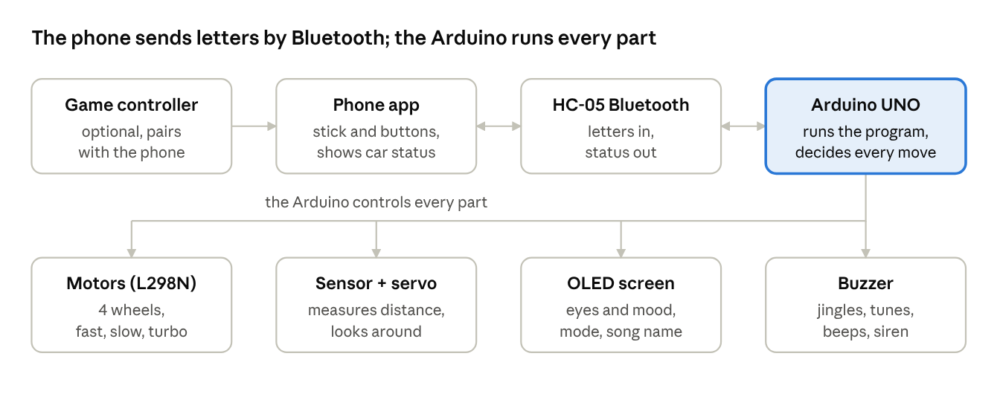

# Robot Car – Everything It Can Do

*Updated Nov 12, 2026 · app 4.2 · also as a [PDF](Robot_Car_Guide.pdf)*

A 4-wheel Arduino robot car you drive from an Android phone, a computer or a game controller. It steers smoothly like a real RC car, avoids walls, dances to 39 songs, plays games, maps the room with a radar, lets you turn its sensor "eyes", and shows a face on its screen. The app shows a live 3D model of the car that does what the real one does.

**Get the app:** [RobotCar.apk](https://github.com/mayaanmalik2486/robot-car/raw/main/App/RobotCar.apk) · **On a computer:** open `Web/index.html` in Chrome or Edge · **Everything:** [github.com/mayaanmalik2486/robot-car](https://github.com/mayaanmalik2486/robot-car)

---

## 1. What changed this week (Oct 20 → Nov 12, 2026)

A week ago the app was version 3.1. It is now 4.2, the car program was improved, and a web version exists. This table shows every change.

### Driving and steering

| | Before (app 3.1) | Now (app 4.2) |
| --- | --- | --- |
| How the car is told to move | 6 fixed letters: forward, back, spin left / right, curve left / right | The app sets the speed of **each side of the car** itself, 31 steps forward and 31 backward |
| Speed | Two speeds only: slow or fast | **The further you push, the faster it goes** (31 steps). Slow / fast is now just the top-speed limit |
| Steering | One fixed sharp curve; nothing in between | Smooth: a little steering = a wide bend, more = tighter, full steering with no throttle = spin on the spot |
| Steering while reversing | Not possible (plain backward only) | Works |
| On-screen controls | One thumbstick, or tilt | A **steering wheel + throttle lever** (new default), one stick, or tilt |
| Phone goes out of range while driving | The car kept driving until it met a wall | The car **stops by itself after 0.6 s** of silence |
| STOP right after starting a mode | Ignored for 1.5 s (the car thought a button was let go) | Always stops at once |
| A mode running while your thumb rests on a stick | Letting go sent "stop" and could end the mode | The controls leave a running mode alone until you let go and push again, or move clearly |
| Turning the sensor head yourself | Not possible | **HEAD page**: a blue wheel turns the sensor head up to 50° each way |

### The app's look

| | Before (app 3.1) | Now (app 4.2) |
| --- | --- | --- |
| Middle of the screen | A small green text screen | A **live 3D car**: wheels spin, the floor moves and turns, it leans in bends, bounces when dancing, sweeps its head in radar mode, meets a red wall when blocked |
| Buttons | Flat grey keys with emoji | **Glossy 3D bubble buttons** in bright colours, with a shine, a glow, a ripple and a springy press |
| Background | Plain dark grey | Night-blue sky with slow floating bubbles |
| Motion | None | Everything rises into place, pages pop in, the tab marker slides, the wheel and lever spring back |
| Pages | Moves, Play, Radar | Moves, Play, Radar, **Head** |
| Screen sizes | One layout for phones held sideways | Re-arranges itself for small phones, big phones, tablets, upright windows and resized windows (tested at 31 sizes) |
| Trying it without the car | Buttons did nothing | The 3D car follows your controls and plays the modes, so you can try everything first |
| Settings | None | A settings screen: driving style, top speed, steering feel, dead zones, haptics, controller badges, reset |

### Game controller (GameSir Cyclone 2)

| | Before (app 3.1) | Now (app 4.2) |
| --- | --- | --- |
| Driving | RT = gas, LT = reverse, left stick = steer (fixed curve) | **Left stick = throttle, right stick = steering**, both smooth, like an RC transmitter |
| Triggers | Gas and reverse | RT = turbo, LT = smooth brake |
| Face buttons | A turbo, B STOP, X kick, Y dance | A dance, B STOP, X kick, Y horn |
| Changing buttons | Not possible | **Every button can be changed**, and each controller remembers its own map |
| Seeing what a button does | A text list | A **live drawing of the controller**: everything you press lights up, with stick and trigger values |
| Sensor head | Not possible | Hold LB + move the right stick |
| Controller modes understood | The basic one | All four Cyclone 2 modes (yellow, green, blue, red light) |
| Connecting a controller | Dropped the link to the car | The link stays up |
| Controller unplugged while driving | Car kept its last order | Car stops at once |
| Rumble | Intruder and low battery | Also a tick when blocked and a pulse for turbo |

### The car program

| | Before | Now |
| --- | --- | --- |
| Steering codes | None | Codes above 127 set each side's speed; the car still stops for walls |
| Sensor head codes | None | Codes 6–26 point the servo (5° a step, 50° each way) |
| Slow / fast while reversing or spinning | Did nothing until you changed direction | Works at once |
| Smooth brake in a curve | Both sides jumped to near full power first, so the car spun | Each side slows from its own speed; a curve stays a curve |
| Reading commands | One letter per loop, so fast input lagged | Every waiting letter is read each loop |
| What it tells the app | Status and song name | Also `#V:3`: "I know steering and the head codes" |
| Memory used (main program) | 30,656 bytes (95.0%) | 31,136 bytes (96.5%) |
| Memory used (fullest song) | 31,510 bytes (97.7%) | 31,988 bytes (99.2%), 268 bytes left |

### New things that did not exist before

| New | What it is |
| --- | --- |
| Web remote | The same remote as a web page for computers (Chrome or Edge), with mouse, keyboard and controller |
| App tests | 131 checks of the driving logic, 93 layout checks, a check of every Android call against Android 5 |
| Preview tool | Draws the app's real screen code to pictures on the PC, so the look can be checked without a phone |
| Old versions kept | Every app version from 1.0 to 4.1 is in `App/Old_APKs` |

---

## 2. At a glance

The phone, computer or controller tells the app what you want. The app sends short codes over Bluetooth: a letter for a mode (4 for dance, I for search), and number codes for the wheel speeds and the sensor head. The Arduino turns them into motor moves, sounds and faces, and sends back what it is doing. The batteries (3 x 18650 cells, plus 4 x AA for the servo) power it all.

## 3. The car

The car is built from cheap, common hobby parts around an Arduino UNO. Each part has one job:

| Part | What it does on this car |
| --- | --- |
| Arduino UNO + Sensor Shield V5 | The brain: runs the program and connects everything |
| L298N motor driver + 4 DC motors | Drives the four wheels; also turns the battery into 5 V for the Arduino |
| HC-05 Bluetooth module | Receives what the phone sends and sends back what the car is doing |
| HC-SR04 ultrasonic sensor | Measures distance (a few cm up to about 1.5 m), like a bat |
| SG90 servo | Turns the distance sensor left and right so the car can look around |
| SSD1306 OLED screen | Shows eyes, the mode, the distance, song names and warnings |
| Passive buzzer | Plays jingles, songs, beeps, the horn and alarms |
| 3 x 18650 cells (+ 4 x AA for the servo) | Power for the motors, the Arduino and the servo |

The program fills 96.5% of the Arduino's memory (up to 99.2% in the song files), so new features have to be tiny. Each play mode can be switched off in the code to free space.

## 4. Driving

### The three ways to drive on the screen

| Style | How it works |
| --- | --- |
| **Wheel** (default) | A **throttle lever** on the left: push it up to go forward, pull it down to reverse. The further you push, the faster. A **steering wheel** on the right: grab it anywhere and turn it, up to 126° each way for full steering. Let go and both spring back; the car stops |
| **1 stick** | One thumbstick: push where you want to go. A little = slowly, all the way = full speed |
| **Tilt** | Hold the round pad and tilt the phone like a steering wheel: tip it away to go forward, toward you to go back. Let go and the car stops |

Tap **WHEEL** at the top of the app to switch between them.

### How the steering works

The app turns "how far is the throttle pushed" and "how far is the steering turned" into a speed for the left wheels and a speed for the right wheels.

| You do | The car does |
| --- | --- |
| Throttle only | Both sides the same speed: straight on |
| Throttle + a little steering | The inner side slows a little: a wide bend |
| Throttle + more steering | The inner side slows more, then stops: a tight bend |
| Full throttle + full steering | The inner side runs backward at 30%: the tightest bend |
| Steering only, no throttle | The two sides run opposite ways at 85%: spin on the spot |
| Reverse + steering | The car backs up while turning |

A setting called **steering feel** makes small movements gentler around the middle, so the car is easy to hold straight.

### Speed, turbo, horn, stop

- **Speed** – follows how far you push, in 31 steps. The lowest step is already strong enough to turn the motors.
- **Fast / slow** – the top-speed limit. Slow is easier indoors. The car's own modes (auto, chaos, donut) use it too.
- **Turbo** – a 1.5-second full-power burst with a whoosh sound and "TURBO!" on the screen. If you are still holding the throttle afterwards, the car drives on.
- **Horn** – "beep beeeep".
- **Stop** – stops everything, including any self-driving or play mode, and centres the sensor head.

While driving forward, the car beeps like a parking sensor, faster as it gets closer to something, and stops by itself at 30 cm. Backing away from a wall is always allowed.

### Older car programs

If the car still runs an older program, the app notices (the car does not answer `#V`) and drives with the 6 old letters instead: forward, backward, spin and one fixed curve, with slow below 75% push and fast above. The app shows "LETTERS (OLD CAR PROGRAM)". Upload the new `Robot_Car_Main`, or any song from `Dances`, to get smooth steering and the head wheel.

## 5. The sensor head (new)

The distance sensor sits on a servo, like a head with two eyes. On the **HEAD** page a blue wheel turns it:

- Turn the wheel right and the head looks right, up to 50° each way, in steps of 5°.
- It **stays** where you leave it (it does not spring back).
- **LOOK STRAIGHT**, or **STOP**, centres it again.
- The 3D car's head turns the same way.
- On a controller: hold **LB** and move the **right stick**.

The car measures distance wherever the head points, so you can look around a corner before driving.

## 6. Self-driving modes

These run by themselves after one tap and keep going until you send another command.

| Mode | What it does |
| --- | --- |
| Auto forward / auto backward | Drives straight on its own and stops at obstacles |
| Search | Turns its sensor to look left, ahead and right, then turns toward the side with the most room and drives there. If it is boxed in, it turns 90° at a time until it finds a way out. It also notices when it is stuck on something the sensor can't see |
| Chaos | Random straight runs, turns, spins and wiggles, a bit slower than full speed so it crashes less. The eyes look angry |
| Donut | Spins round and round. When you stop it, it shows dizzy eyes and wobbles its head |
| 180° turn | Turns round to face the other way |
| Brake | Slows down smoothly instead of stopping dead; in a bend it keeps the bend |
| Radar | Stands still and sweeps its sensor 50° each way. Its screen draws a radar map with a dot for everything within 1.5 m. The app draws the same map, and shows the dots on the floor round the 3D car |

## 7. Play modes

Six games that use only the parts already on the car. They all use the distance sensor, even in football mode.

| Mode | What it does |
| --- | --- |
| Follow me | Keeps about 25 cm from your hand or feet: follows when you walk away, backs off when you come closer than 18 cm, and looks around with the servo if it loses you (nothing within 90 cm) |
| Goalkeeper + kick | Scans for the ball, turns to face it and punches it away (a quick dash forward and back) when it comes within 30 cm. Kick shoots any time |
| Guard | Counts down with 5 beeps (walk away), learns what the room looks like, then sounds a siren, shows angry eyes and "INTRUDER", turns to face whoever came in, and makes your phone and controller vibrate |
| Music | Your hand is the instrument: its distance (5–60 cm) plays notes on a pleasant-sounding scale, like a theremin |
| Gestures | Tap = spin round, double tap = happy wiggle, hold your hand close = it backs away, hold it further = it comes to you |
| Pet | A little robot pet: wanders slowly, sits and looks around, gets bored, falls asleep snoring, and wakes up purring when you "pet" it by holding your hand close |

## 8. Dancing

The car dances to 39 songs in time with the music, each with its own choreography. Every song is a separate copy of the full program (in the [Dances](../Dances) folder), so you upload the song you want and every other feature still works, including the new steering and head wheel.

- **Real choreography** – each song has signature moves and a routine for each part (intro, verse, chorus, drop). The chorus routine comes back every chorus, phrases end on a pose, and spins go exactly once round and finish facing the front.
- **Stays in place** – every step brings the car back to its spot, and it never dances forward into anything closer than 30 cm.
- **Music from the buzzer** – it plays an original tune in the song's key (bass on the beat plus a melody), not the real melody.
- **Staying in time** – start the song on a speaker and press dance on the first beat. If it drifts, tap dance again on a beat and it lines itself up without restarting.
- **On the car's screen** – the song name, the part (INTRO / VERSE / CHORUS / DROP!) and the time in the song.
- **In the app** – the song name at the top, a dance clock, and the 3D car bounces on a floor that changes colour.

The 39 songs mix Bollywood and Pakistani hits (Badtameez Dil, Ambarsariya, Chammak Challo, Aal Izz Well), hip-hop and pop (God's Plan, Flashing Lights, Get Lucky, They Don't Care About Us), TV themes (all five Ben 10 themes, The Mentalist, Suits) and more. The full list with timings is in [Dances/README.md](../Dances/README.md).

## 9. Face, sounds and switches

The car has a personality: the screen shows its mood and the buzzer gives every action a sound.

- **Eyes** – two cartoon eyes that blink and look where the sensor is looking. They change with the mode: happy (hello, dance), angry (chaos, guard), focused (search), sleepy (bored pet), surprised (emergency stop) and dizzy (after a donut).
- **Radar map** – in radar mode the eyes make way for the radar picture: range rings, the sweep line and dots, with "RADAR near 42cm" on top.
- **Hello** – when you switch it on, and when the phone sends its first command, it shows "Hello!", plays a tune and waves the servo.
- **Sounds** – a jingle for each mode, the dance tunes, parking beeps, the horn, the guard siren and warning beeps.
- **Mute** – turns every sound off; again turns sound back on. (Controller: SELECT.)
- **Football mode** – switches the distance sensor off, so the car never stops for things and you can push a ball or bump into stuff. Search, chaos and the play modes still use the sensor. (Controller: RB.)

## 10. Safety and battery

| Protection | How it works |
| --- | --- |
| Obstacle stop | Driving forward, it stops by itself at 30 cm, shows surprised eyes and beeps. Football mode turns this off on purpose |
| Out of range | With the new steering, the app repeats the wheel speeds every 0.2 s. If the car hears nothing for 0.6 s it stops by itself |
| App closed or in the background | The app sends stop first |
| Controller unplugged | The car stops at once |
| STOP button | Always works, even right after starting a mode |
| Closing the app by accident | Back must be pressed twice |
| Connection lost | The app says so and offers **Reconnect** |
| Low battery | The car checks its own power without extra wires. When the battery is nearly empty it shows a warning, plays a sad tune and makes your phone and controller vibrate. It cannot show a percentage |

## 11. The app (Android, version 4.2)

Download: [RobotCar.apk](https://github.com/mayaanmalik2486/robot-car/raw/main/App/RobotCar.apk). It installs over older versions. Install guide: [App/README.md](../App/README.md). It works on Android 5 and newer. It cannot work on iPhones, because Apple doesn't let apps talk to HC-05 modules.

### The main screen

| Where | What |
| --- | --- |
| Top | **Connect** (shows the car when connected) · the song this car dances to · your controller (tap for the controller screen) · **FAST / SLOW** · **WHEEL / 1 STICK / TILT** · settings · help |
| Left | The throttle lever (or the stick) |
| Middle, top | The live 3D car, with the status written over it |
| Middle | **STOP** and four action bubbles: Dance, Kick, Horn, Turbo |
| Middle, bottom | Four pages: **Moves**, **Play**, **Radar**, **Head** |
| Right | The steering wheel (with 1 stick or tilt: STOP and the action bubbles) |

### What the 3D picture shows

- **Top left** – connected or not, and whether the car uses smooth **steering** or the old **letters**.
- **Big words** – what the car is doing: READY, DRIVE 82%, DANCE 0:12, RADAR 38 cm, BLOCKED, and so on.
- **Small switches** – sound, sensor, speed, battery. A red dot means off or low.
- **Two bars on the right** – how hard each side of the car is working, up for forward and down for backward.
- **The car itself** – wheels spin, the floor moves, it leans, bounces, turns its head, and meets a red wall when blocked.

Hold the picture to see the **link log**: everything the app sent and everything the car answered.

### The pages

| Page | Buttons |
| --- | --- |
| Moves | Search, Chaos, Donut, 180°, Auto, Reverse, Brake, Horn |
| Play | Follow me, Goalkeeper, Guard, Music, Gestures, Pet |
| Radar | A live radar map and a start / stop button |
| Head | The blue head wheel and LOOK STRAIGHT |

The button of the mode that is running glows. With a controller connected, each button shows a small badge with the controller button that does the same job.

### Settings

| Setting | What it does |
| --- | --- |
| On-screen controls | Wheel + lever, 1 stick or tilt |
| Top speed | Fast or slow |
| Steering feel | Direct, or gentle around the middle |
| On-screen dead zone | How far a control moves before the car does |
| Controller stick dead zone | The same for the controller's sticks (kept per controller) |
| The left stick steers too | One-thumb driving on a controller |
| Show the controller's buttons | The little badges on the screen's buttons |
| Haptics | The little click when you press a button |
| Reset | Everything back as it came |

## 12. Game controller (GameSir Cyclone 2)

The controller cannot talk to the car directly. The car's HC-05 only talks to phones and computers, so the controller connects to the phone and the app passes everything on.

**Connecting it to the phone:**
- **Bluetooth:** hold HOME + A for 2 seconds until the light flashes yellow, then pick "GameSir-Cyclone 2" in the phone's Bluetooth list. (GameSir's manuals disagree on this combination; if it doesn't work, use the yellow mode button.)
- **Dongle:** plug the 2.4 GHz dongle into the phone with a USB-C adapter (light green).

| Controller | Does |
| --- | --- |
| Left stick up / down | Throttle: the further you push, the faster |
| Right stick left / right | Steering (no throttle = spin on the spot) |
| RT | Turbo |
| LT | Smooth brake |
| A | Dance |
| B | STOP |
| X | Kick |
| Y | Horn |
| RB | Football mode |
| LB | SHIFT: hold it for the second jobs below |
| D-pad up / right / down / left | Search / chaos / donut / 180° turn |
| START | Radar |
| SELECT | Mute |
| L3 / R3 (click the sticks) | Auto forward / auto backward |
| HOME | Android's own |

| Hold LB + | Does |
| --- | --- |
| A / B / X / Y | Follow me / guard / goalkeeper / pet |
| D-pad up / down | Music / gestures |
| D-pad left / right | Top speed slow / fast |
| Right stick left / right | Turn the sensor head |

**Changing buttons:** Settings > Controller buttons and remap. Tap a button on the drawing and pick its new job, or press Remap, pick a job, then press the button. The back buttons M1 / M2 have no job of their own: set them in the GameSir app to copy any button.

**Rumble:** a long rumble for an intruder, a medium one for low battery, a short tick when blocked, a short pulse for turbo.

## 13. The web remote (computers)

The same remote as a web page, for Chrome or Edge on Windows, Mac, Linux or a Chromebook.

1. Pair the car's HC-05 with the computer (PIN 1234 or 0000).
2. Open `Web/index.html` and click **Connect**.

| Drive with | How |
| --- | --- |
| Mouse or finger | Push the lever and turn the wheel |
| Keyboard | W A S D or the arrows, Space = STOP, Enter = dance, H horn, K kick, T turbo, B brake, R radar, M mute, F football, Q fast / slow |
| Controller | Plug the Cyclone 2's dongle into the computer; the same map as the app |

Safari and Firefox cannot do this, and neither can an iPhone or iPad. More: [Web/README.md](../Web/README.md).

## 14. What the app and car say to each other

| From the app | Means |
| --- | --- |
| A letter (F, B, L, R, G, H, S, Q, W, T, Y, 4, I, 1, 2, J, 3, U, u, M, K, k, A, N, E, P, O, X, V, ?) | Drive letters, speed, actions and modes, as before. None of them changed |
| A code from 128 to 255 | The speed of one side of the car: 128 + 64 for the right side + speed + 32, where speed is -31 to 31 |
| A code from 6 to 26 | Point the sensor head: 6 = 50° right, 16 = straight, 26 = 50° left |

| From the car | Means |
| --- | --- |
| `~DRIVE\|0010` | What it is doing, then 1 / 0 for muted, football, slow, low battery |
| `#S:Robot Groove` | The song it dances to |
| `#V:3` | It knows the steering codes and the head codes |
| `#R:f42` | Radar: direction a (50° right) to k (50° left), distance in cm |

The app never floods the car: wheel speeds go out only when they change, at most every 60 ms, and are repeated every 0.2 s while driving.

## 15. How it was tested

Nothing below needs the real car; it all runs on the computer.

| Test | What it checks |
| --- | --- |
| Car simulator | Runs the real compiled car program in a simulated Arduino with a pretend phone, sensor, servo, buzzer and screen: steering, the head codes, the 0.6 s safety stop, walls, every mode, every dance |
| App logic (131 checks) | The driving brain: nothing sent at rest, stop on release, the rate limit, steering maths, parked controls during modes, STOP, the controller map, button presses |
| App replay | A drive made by the app's real logic is played to the simulated car and the wheels are checked |
| Layout (93 checks) | Nothing overlaps or is cut off at 31 screen sizes in 3 driving styles |
| Android versions | Every Android call checked against Android 5 |
| Web against app | The web page's logic gives exactly the same layout, wheel speeds and codes as the app's |
| Preview (21 checks) | The app's real drawing code is run and drawn to pictures; the lever and wheel are driven with pretend fingers |

**Not tested:** a real phone, the real car and the real Cyclone 2. Things to try on the real ones: the letters fit the buttons, the animations are smooth, the wheel feels right, the car stops when you walk out of range, the head turns the same way as the blue wheel, the servo doesn't strain at its ends, and the controller rumbles.

## 16. Extras

- **IR remote add-on** – the TV-style IR remote was taken out to make room. One file plus 3 lines puts it back ([IR_Remote_Addon](../IR_Remote_Addon)), but memory is now very tight, so something else has to be switched off.
- **Update all songs in one click** – change the main program, double-click `UPDATE_ALL_SONGS.bat`, and all 39 song programs get the change (each keeps its own dance), then it checks that they all compile and fit.
- **Every old version kept** – all earlier versions of the car code, the dances from before the choreography, and every app version from 1.0 to 4.1.
- **Ready to upload** – every program is already set to Arduino Uno on COM4.

## 17. Limits and ideas for later

- **Memory is nearly full** – 96.5% for the main program and up to 99.2% in song files; the fullest has 268 bytes left. Any new car feature needs something else switched off.
- **Android and computers only** – no iPhone app or web page is possible with the HC-05.
- **Battery** – it warns only when nearly empty; a real battery meter needs two resistors.
- **The sensor sees only where the head points** – thin, soft or angled things (chair legs, cushions) can be missed.
- **The website is not online yet** – GitHub Pages must be switched on in the repo settings; until then, open `Web/index.html` from the folder.
- **Not yet tried on real hardware** – see section 15.

Ideas saved for later: record and replay a route, more emoji faces and sound effects, games on the screen (reaction game, Simon says), a wall follower for mazes, a line follower or table-edge stop, and a real battery meter. More in [IDEAS.md](../IDEAS.md).
