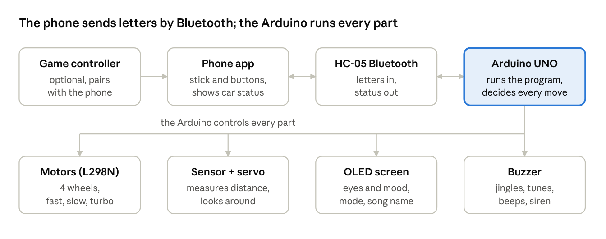

# Robot Car – Everything It Can Do

*Oct 19, 2026 · also as a [PDF](Robot_Car_Guide.pdf)*

A 4-wheel Arduino robot car you drive from an Android phone. It avoids walls, dances to 39 songs, plays games, shows a face on its screen, and works with a game controller through the phone.

## At a glance

Every button in the app sends one letter (F for forward, 4 for dance, and so on) over Bluetooth. The Arduino turns it into motor moves, sounds and faces, and sends back what it is doing. The batteries (3 x 18650 cells, plus 4 x AA for the servo) power it all.

## The car

The car is built from cheap, common hobby parts around an Arduino UNO. Each part has one job:

| Part | What it does on this car |
| --- | --- |
| Arduino UNO + Sensor Shield V5 | The brain: runs the program and connects everything |
| L298N motor driver + 4 DC motors | Drives the four wheels; also turns the battery into 5 V for the Arduino |
| HC-05 Bluetooth module | Receives the letters the phone sends and sends back what the car is doing |
| HC-SR04 ultrasonic sensor | Measures distance (a few cm up to about 1.5 m), like a bat |
| SG90 servo | Turns the distance sensor left and right so the car can look around |
| SSD1306 OLED screen | Shows eyes, the mode, the distance, song names and warnings |
| Passive buzzer | Plays jingles, songs, beeps, the horn and alarms |
| 3 x 18650 cells (+ 4 x AA for the servo) | Power for the motors, the Arduino and the servo |

The program fills about 92% of the Arduino's memory, so new features have to be small. Each play mode can be switched off in the code to free space.

## Driving

You drive with the thumbstick in the app (or a game controller): the car moves while you hold it and stops the moment you let go.

- **Forward / backward** – push the stick up or down.
- **Spin left / right** – push it sideways; the car turns on the spot (wheels on each side go opposite ways).
- **Curve left / right** – push it diagonally up; the car drives forward while turning, like a car round a bend. The inside wheels run backward at 30% for a sharp turn.
- **Fast / slow** – two speeds; slow is easier indoors.
- **Turbo** – a 1.5-second full-power burst with a whoosh sound and "TURBO!" on the screen.
- **Horn** – "beep beeeep".
- **Stop** – stops everything, including any self-driving or play mode.

While driving forward, the car beeps like a parking sensor, faster as it gets closer to something, and stops by itself at 30 cm.

## Self-driving modes

These run by themselves after one tap and keep going until you send another command.

| Mode | What it does |
| --- | --- |
| Auto forward / auto backward | Drives straight on its own and stops at obstacles |
| Search | Turns its sensor to look left, ahead and right, then turns toward the side with the most room and drives there. If it is boxed in, it turns 90° at a time until it finds a way out. It also notices when it is stuck on something the sensor can't see |
| Chaos | Random straight runs, turns, spins and wiggles, a bit slower than full speed so it crashes less. The eyes look angry |
| Donut | Spins round and round. When you stop it, it shows dizzy eyes and wobbles its head |
| 180° turn | Turns round to face the other way |
| Brake | Slows down smoothly instead of stopping dead |

## Play modes

Six games that use only the parts already on the car. They all use the distance sensor, even in football mode.

| Mode | What it does |
| --- | --- |
| Follow me | Keeps about 25 cm from your hand or feet: follows when you walk away, backs off when you come closer than 18 cm, and looks around with the servo if it loses you (nothing within 90 cm) |
| Goalkeeper + kick | Scans for the ball, turns to face it and punches it away (a quick dash forward and back) when it comes within 30 cm. Kick shoots any time |
| Guard | Counts down with 5 beeps (walk away), learns what the room looks like, then sounds a siren, shows angry eyes and "INTRUDER", turns to face whoever came in, and makes your phone vibrate |
| Music | Your hand is the instrument: its distance (5–60 cm) plays notes on a pleasant-sounding scale, like a theremin |
| Gestures | Tap = spin round, double tap = happy wiggle, hold your hand close = it backs away, hold it further = it comes to you |
| Pet | A little robot pet: wanders slowly, sits and looks around, gets bored, falls asleep snoring, and wakes up purring when you "pet" it by holding your hand close |

## Dancing

The car dances to 39 songs in time with the music, each with its own choreography. Every song is a separate copy of the full program (in the [Dances](../Dances) folder), so you upload the song you want and every other feature still works.

- **Real choreography** – each song has signature moves and a routine for each part (intro, verse, chorus, drop). The chorus routine comes back every chorus, phrases end on a pose, and spins go exactly once round and finish facing the front.
- **Stays in place** – every step brings the car back to its spot, and it never dances forward into anything closer than 30 cm.
- **Music from the buzzer** – it plays an original tune in the song's key (bass on the beat plus a melody), not the real melody.
- **Staying in time** – start the song on a speaker and press dance on the first beat. If it drifts, tap dance again on a beat and it lines itself up without restarting.
- **On the screen** – the song name, the part (INTRO / VERSE / CHORUS / DROP!) and the time in the song.

The 39 songs mix Bollywood and Pakistani hits (Badtameez Dil, Ambarsariya, Chammak Challo, Aal Izz Well), hip-hop and pop (God's Plan, Flashing Lights, Get Lucky, They Don't Care About Us), TV themes (all five Ben 10 themes, The Mentalist, Suits) and more. The full list with timings is in [Dances/README.md](../Dances/README.md).

In the simulator, every move in all 39 dances landed on the beat (12,624 of 12,624) and every buzzer note was right.

## Face, sounds and switches

The car has a personality: the screen shows its mood and the buzzer gives every action a sound.

- **Eyes** – two cartoon eyes that blink and look where the sensor is looking. They change with the mode: happy (hello, dance), angry (chaos, guard), focused (search), sleepy (bored pet), surprised (emergency stop) and dizzy (after a donut).
- **Hello** – when you switch it on, and when the phone sends its first command, it shows "Hello!", plays a tune and waves the servo.
- **Sounds** – a jingle for each mode, the dance tunes, parking beeps, the horn, the guard siren and warning beeps.
- **Mute** – one button turns every sound off; press again to turn sound back on.
- **Football mode** – switches the distance sensor off, so the car never stops for things and you can push a ball or bump into stuff. Search, chaos and the play modes still use the sensor. Press again to switch it back on.

## Safety and battery

The car protects itself from crashes and warns you before the battery dies.

- **Obstacle stop** – when driving forward it stops by itself at 30 cm, shows surprised eyes and beeps. Football mode turns this off on purpose.
- **Stops when the app closes** – if you leave the app or lose the connection while driving, the app sends stop first.
- **Low-battery warning** – the car checks its own power without any extra wires. When the battery is nearly empty it shows a warning on the screen, plays a sad tune and makes your phone vibrate. Without extra parts it can only notice when the battery is nearly empty, not show a percentage.

## The app

The car has its own Android app, laid out like a game controller and held sideways. Anyone can download it from one link: [RobotCar.apk](https://github.com/mayaanmalik2486/robot-car/raw/main/App/RobotCar.apk) (45 KB). Install guide: [App/README.md](../App/README.md).

- **Left** – a thumbstick to drive, with a fast/slow button above it.
- **Right** – four round coloured buttons like a real controller: dance (yellow), kick (blue), horn (red), turbo (green), with a big red STOP above them.
- **Middle** – a small green screen showing whether it is connected, what the car is doing right now, and mute / football / speed / battery. Under it are emoji buttons for every other mode; hold one to see its name.
- **Live status** – the car tells the app what it is doing, so the screen is always up to date.
- **Alerts** – the phone vibrates and shows a message when guard mode sees an intruder or the battery is low.
- **Easy connecting** – pick the HC-05 once; after that the app connects by itself when opened. The screen stays on and full-screen while you play.
- **Sharing** – a Share button in the help sends the download link to friends.

It works on Android 5 and newer. It cannot work on iPhones, because Apple doesn't let apps talk to HC-05 modules.

## Game controller

A game controller like the GameSir Cyclone 2 can drive the car through the phone, but not directly. The car's HC-05 only talks to phones and computers, so the controller connects to the phone (by Bluetooth, or its USB dongle with a USB-C adapter) and the app passes its buttons on to the car.

| Controller | Does |
| --- | --- |
| Left stick or D-pad | Drive (diagonals curve) |
| A / B / X / Y | Turbo / horn / kick / dance |
| LB / RB | Fast-slow / STOP |
| LT / RT | Brake / turbo |
| START / SELECT | Search / football |
| Left stick click | Sound on / off |

If the Cyclone 2 asks for a mode, pick its Android or Xbox mode.

## Extras

Everything lives in one public GitHub repo, [mayaanmalik2486/robot-car](https://github.com/mayaanmalik2486/robot-car), so it can be opened and downloaded from anywhere.

- **IR remote add-on** – the TV-style IR remote was taken out to make room. One file plus 3 lines puts it back in any program, with a 4-step guide ([IR_Remote_Addon](../IR_Remote_Addon)).
- **Update all songs in one click** – change the main program, double-click UPDATE_ALL_SONGS.bat, and all 39 song programs get the change (each keeps its own dance), then it checks that they all compile.
- **Simulator tests** – a computer simulator runs the real program and checks the modes, the timing and every dance; the last run passed 386 of 386 checks.
- **Every old version kept** – all earlier versions of the code and the dances from before the choreography are saved in their own folders.
- **Ready to upload** – every program is already set to Arduino Uno on COM4.

## Limits and ideas for later

A few things the car and app can't do yet:

- **Memory is nearly full** (92%) – big new features need something else switched off. The IR add-on fits in every program, but on the biggest song file pet mode has to be switched off to make room.
- **Android only** – no iPhone app is possible with the HC-05.
- **Battery** – it warns only when nearly empty; a real battery meter needs two resistors.
- **The sensor sees only straight ahead** – thin, soft or angled things (chair legs, cushions) can be missed.
- **Not yet tried on a real phone** – the new app and the controller support are built and checked on the computer only.

Ideas saved for later: a radar screen (the servo sweeps and the screen draws a map), record and replay a route, more emoji faces and sound effects, games on the screen (reaction game, Simon says), a wall follower for mazes, a line follower or table-edge stop (if the old sensors are still around), and a real battery meter. More in [IDEAS.md](../IDEAS.md).
