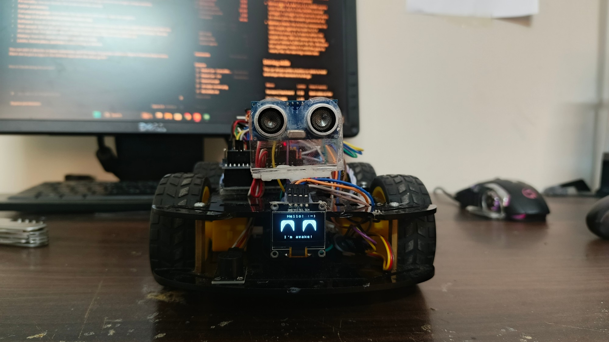
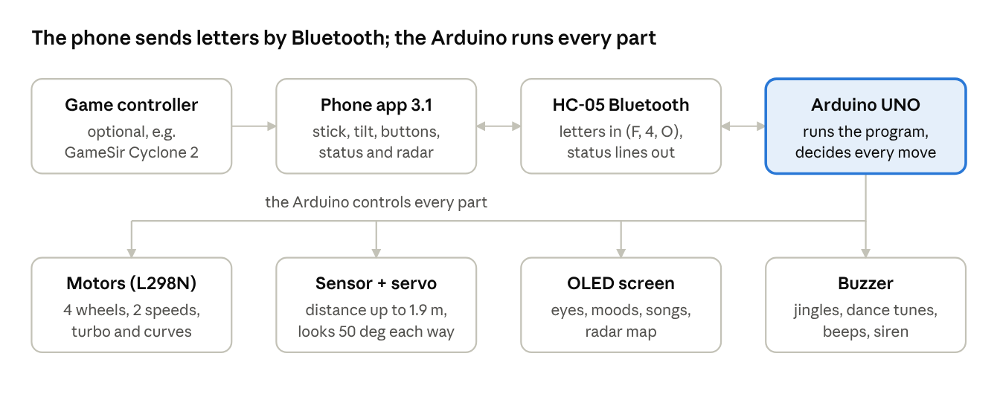

# Robot Car – CV

*Oct 20, 2026 · also as a [PDF](Robot_Car_CV.pdf)*

## Profile

A 4-wheel-drive Arduino robot car that drives from a phone or game controller, avoids obstacles, maps the room with radar, plays six games and dances to 39 songs with real choreography. Built by Muhammad Ayaan Malik, from a starter tutorial (version 0) to version 9 plus play modes, radar and its own Android app (October 2026).

| | |
| --- | --- |
| Name | Robot Car (program: Robot_Car_Main, v9 + play modes + radar) |
| Brain | Arduino UNO (ATmega328P, 32 KB program memory, 2 KB RAM) on a Sensor Shield V5 |
| Drive | 4 DC motors through an L298N driver, 2 speeds (full 255, slow 153) |
| Senses | HC-SR04 ultrasonic distance sensor on an SG90 servo (looks 50° left and right) |
| Shows | 128 x 64 SSD1306 OLED screen: animated eyes, mode, distance, song, radar map |
| Sounds | Passive buzzer: jingles, dance tunes, parking beeps, horn, siren |
| Talks | HC-05 Bluetooth at 9600 baud, to its own Android app |
| Power | 3 x 18650 cells (motors + Arduino), 4 x AA (servo) |
| Skills | 7 driving moves, 6 self-driving modes, 6 play modes, radar, 39 dances |
| Program size | 30,656 bytes (95.0% of memory); song versions up to 97.7% |
| Tested | 394 of 394 simulator checks pass; every dance move lands on the beat |
| Code | Public on GitHub: [mayaanmalik2486/robot-car](https://github.com/mayaanmalik2486/robot-car) |

## How it works

Every button, stick move or controller press becomes one letter sent over Bluetooth. The Arduino turns it into motor moves, sounds, faces and sensor sweeps, and sends back what it is doing, its song and radar readings.

## Hardware and wiring

Every part plugs into the Sensor Shield V5, where each pin has a row of three: signal (S), +5 V (V) and ground (G).

| Part | Job | Pins |
| --- | --- | --- |
| Arduino UNO + Sensor Shield V5 | Runs the program, connects everything | – |
| L298N motor driver | Drives the wheels; its 5 V output powers the Arduino | ENA D5 (left speed), ENB D6 (right speed), IN1 D2, IN2 D4 (left direction), IN3 D7, IN4 D10 (right direction) |
| 4 DC motors | Two on each side, wired side by side | OUT1 + OUT2 left, OUT3 + OUT4 right |
| HC-05 Bluetooth | Letters in from the phone, status out | TXD → D3 (Arduino listens), RXD → A0 (Arduino talks) |
| HC-SR04 ultrasonic sensor | Measures distance up to about 1.9 m | TRIG D11, ECHO D12 |
| SG90 servo | Turns the sensor: 40° = right, 90° = ahead, 140° = left | D9 |
| SSD1306 OLED, 128 x 64 | Eyes, text, radar picture | SDA A4, SCL A5 (I2C at 400 kHz, address 0x3C or 0x3D) |
| Passive buzzer board | All sounds, made by a tone generator on Timer2 (about 19.8 kHz) | A1 |
| IR receiver (add-on only) | TV-style remote | D8 |

Free pins: A2 and A3 (A3's noise seeds the random numbers for chaos mode). The USB pins D0 and D1 stay free for uploading.

## Power

Two separate battery packs keep the servo's current spikes away from the Arduino.

- **Main pack: 3 x 18650 cells** → on/off switch → L298N motor input. The L298N's 5 V regulator (jumper ON) feeds the Arduino's 5 V pin; the grounds are joined.
- **Servo pack: 4 x AA** (4 x 1.2 V NiMH works even better: 4.8 V is the SG90's normal voltage) → straight to the servo's red wire. Its minus joins the shield's ground at A2.
- **Battery check:** the Arduino measures its own supply against its built-in 1.1 V reference every 2 s. It warns when the supply drops 300 mV below its starting value or below 4,300 mV for 10 s. Because the regulator holds 5 V until the pack is nearly flat, the warning comes late.

## Driving skills

The car drives while a button or stick is held and stops the moment it is let go.

| Move | Letter | How it works |
| --- | --- | --- |
| Forward / backward | F / B | Both sides at the current speed |
| Spin left / right | L / R | Sides turn opposite ways at 85% of the speed, on the spot |
| Curve left / right | G / H | Forward while turning: the inner wheels run backward at 30% for a sharp bend |
| Stop | S | Stops everything, including any mode |
| Fast / slow | W / Q | Full power (255) or 60% (153) |
| Turbo | T | 1.5 s at full power with a whoosh and "TURBO!"; still stops for walls unless football mode is on |
| Smooth brake | u | Lowers the power by 10 every 40 ms instead of stopping dead |
| Horn | Y | "Beep beeeep" (880 Hz) |

**Obstacle stop:** driving forward, it measures the distance three times per check (15 ms apart) and keeps the middle value. At 30 cm it stops, giving the wheels a 70 ms burst in reverse so it stops short, and shows surprised eyes for 1 s.

**Parking beeps:** from 80 cm, 1,650 Hz beeps come faster as it gets closer: every 600 ms far away, every 90 ms when very close.

## Self-driving modes

One tap starts them; they keep going until another command arrives. An "S" sent within 1.5 s of the tap (a phone button being let go) is ignored so the mode keeps running.

| Mode | Letter | What it does |
| --- | --- | --- |
| Auto forward / backward | 2 / J | Drives straight by itself and stops at obstacles |
| Search | I | Stops, backs up 120 ms, looks left, right and ahead with the servo, then turns toward the side with the most room in 60 ms steps (about 20° each) until at least 100 cm is clear, plus one extra step so the whole car clears the edge. Boxed in: turns 90° at a time. If the distance ahead hasn't changed for 1.5 s while driving (stuck on something it can't see), it backs up 300 ms and turns |
| Chaos | 1 | Random straight runs (0.4–1.3 s), turns (0.12–0.45 s), a 15% chance of a spin (0.4–0.9 s) and a 15% chance of a reverse wiggle, at 75% speed. Obstacle: backs up 250 ms and turns. Angry eyes |
| Donut | 3 | Spins round and round; stopped, it shows dizzy eyes and wobbles its head ±25° for 1.3 s |
| 180° turn | U | Spins exactly 455 ms, tuned to half a turn on this car (a 90° turn is 227 ms) |

## Play modes

Six games built from the parts already on the car. They always use the distance sensor, even in football mode, and "see" anything closer than 150 cm. Each can be switched off in the code to free memory.

| Mode | Letter | How it plays |
| --- | --- | --- |
| Follow me | M | Keeps 18–30 cm from your hand or feet at 65% speed: follows past 30 cm, backs off under 18 cm. Nothing within 90 cm: it looks at 5 angles and turns toward the nearest thing |
| Goalkeeper | K | Scans for the ball, turns to face it, and punches it away (a 220 ms dash forward and back) when it comes within 30 cm |
| Kick | k | Shoots straight away (starts goalkeeper if needed) |
| Guard | A | Beeps 5 times (time to walk away), learns the room, then watches. Anything 25 cm closer than the room was = intruder: siren, angry eyes, "INTRUDER", it turns to face them and the phone vibrates. Calms down 5 s after they leave |
| Music | N | A hand theremin: hand distance 5–60 cm plays notes on a pentatonic scale (closer = higher); farther = silence |
| Gestures | E | Hand within 35 cm: quick tap (under 450 ms) = spin round, double tap = happy wiggle, held under 12 cm for 700 ms = it backs away, held further for 1.4 s = it comes to you |
| Pet | P | Wanders at 50% speed, sits and looks around, gets bored after 25 s, falls asleep snoring after 45 s, and purrs with happy eyes when "petted" (a hand within 25 cm) |

## Radar

The car stands still and sweeps its sensor across 11 directions, 10° apart (50° right to 50° left and back), one step every 160 ms – a full sweep in about 2 s.

- **On the car's screen:** the eyes make way for a radar picture – the car at the bottom, dotted rings at 75 cm and 150 cm, the sweep line, and a 3 x 3 dot for everything within 150 cm. The top row reads "RADAR near 42cm".
- **In the app:** every reading is sent as a line like `#R:f42` (direction a = far right … f = ahead … k = far left, then cm). The app's Radar page draws the same map with rings at 50, 100 and 150 cm; dots fade over 6 s.
- **Start / stop:** letter O (app Radar page, or START on a controller); any other command stops it.
- **Cost:** about 0.9 KB of program memory; switch HAS_RADAR off to free it.

## Dancing

The car dances whole songs in time with the music, each with its own choreography. Every song is a full copy of the program (in the [Dances](../Dances) folder) with its own tempo, key, dance steps and routine, so every other skill still works.

- **Choreography:** signature moves per song and a routine for each part (intro, verse, chorus, drop). The chorus routine returns every chorus, phrases end on a pose, the bar before a big part is a lead-in, the last bar is a finale.
- **Moves:** spins, twists, sways, dashes, looks and freezes, soft (gentler) versions, and "round" spins that go exactly once round and finish facing the front. Every step returns the car to its spot; it never dances forward into anything closer than 30 cm.
- **Music:** the buzzer plays an original tune in the song's key – bass on the beat plus a melody that follows the chords – not the real melody. A few songs have a special moment that flashes text on the screen with a zap sound.
- **Staying in time:** press dance on the first beat; tap again on any beat and it lines itself up without restarting. The screen shows the song name (scrolling if long), the part and the time in the song.
- **Accuracy:** in the simulator, 12,624 of 12,624 moves landed on the beat and 18,288 of 18,288 notes were right.

| Song | Artist | Length | Tempo | Key |
| --- | --- | --- | --- | --- |
| Aal Izz Well (3 Idiots) | Sonu Nigam, Shaan, Swanand Kirkire | 4:36 | 120 | D# major |
| Aankhen Milaney Waaley | Nazia & Zoheb Hassan | 3:34 | 107.4 | F# major |
| Ambarsariya | Sona Mohapatra | 4:08 | 90 | E minor |
| Baba Bandook | Ali Azmat & Haroon | 3:53 | 88.5 | D major |
| Badtameez Dil | Benny Dayal & Shefali Alvares (Pritam) | 4:13 | 106 | D minor |
| Ben 10 (original theme) | Moxy | 1:01 | 136 | D# minor |
| Ben 10: Alien Force theme | Andy Sturmer | 0:31 | 135 | C minor |
| Ben 10: Ultimate Alien theme | Carter, McCuistion & Ritmanis | 0:21 | 85 | C minor |
| Ben 10: Omniverse theme | Parry Gripp | 0:20 | 98 | B minor |
| Ben 10: Omniverse (kid Ben opening) | Parry Gripp | 0:21 | 98 | B minor |
| Bolve | Madan Maddi & Sukshinder Shinda | 5:12 | 114 | E minor |
| Chammak Challo (Ra.One) | Akon & Hamsika Iyer | 3:47 | 134.3 | B minor |
| Confidence | Kim | 3:44 | 88 | C# major |
| Copacabana | Barry Manilow | 4:05 | 116.6 | D# major |
| Distractions | Haiti Babii | 2:32 | 101 | D major |
| Feet Don't Fail Me Now | Joy Crookes | 3:18 | 113 | A# minor |
| Flashing Lights | Kanye West feat. Dwele | 3:57 | 90.5 | F# minor |
| Get Lucky (Drumless Edition) | Daft Punk | 6:09 | 116 | F# minor |
| God's Plan | Drake | 3:19 | 77 | E minor |
| Greenback Boogie (Suits theme) | Ima Robot | 0:31 | 143 | F major |
| Iraaday | Rovalio & Abdul Hannan | 2:13 | 90 | F# major |
| Kabhi Kabhi Aditi | Rashid Ali (A.R. Rahman) | 3:38 | 95 | G minor |
| Loser | Tame Impala | 3:44 | 83 | A# minor |
| Love Me | JMSN | 4:33 | 81 | A# minor |
| Loverboy | A-Wall | 3:45 | 120 | C major |
| My Destiny (Slowed) | Delinquent feat. KCAT | 4:39 | 106 | A minor |
| My Type | Saint Motel | 3:26 | 118 | C minor |
| National Treasures | Drake | 3:20 | 129.5 | G# minor |
| oh yeah? | Steve Lacy | 2:51 | 73 | C# major |
| Save Me | Remy Zero | 4:01 | 96 | E major |
| Sh-Boom | The Chords | 2:26 | 68.5 | F major |
| the kill 2 | Lex Amarni & 2muchmotion | 2:01 | 103 | D minor |
| The Mentalist (main title) | Blake Neely | 1:08 | 105 | D minor |
| The Night Begins to Shine | B.E.R. | 3:30 | 130 | E minor |
| They Don't Care About Us | Michael Jackson | 4:44 | 90 | D minor |
| Touch The Sky | Kanye West feat. Lupe Fiasco | 3:57 | 106.7 | B minor |
| Upside Down | Diana Ross | 4:05 | 108.5 | G minor |
| We Are The People | Empire Of The Sun | 4:32 | 123.4 | E minor |
| worry | LONOWN feat. riserayss | 3:01 | 99 | B major |

Tempo is in beats per minute. The main program (no song file) dances to its own built-in "Robot Groove" at 120 BPM.

## Personality

The screen gives the car a face and the buzzer gives every action a sound.

- **Eyes:** two rounded eyes in the middle six rows of the screen, animated at up to one frame every 60 ms and drawn tile by tile so only changed parts are sent. They blink every 2–4.5 s (150 ms) and look where the sensor looks.
- **Moods:** happy (hello, dance), angry (chaos, guard alarm), fierce (turbo), focused (search), squinting (braking), sleepy (25 s with nothing to do), surprised (emergency stop, 1 s), dizzy with wobbling eyes (after a donut), purring (petted).
- **Screen text:** top row = Bluetooth, speed and warnings (or the song name while dancing); bottom row = what it is doing and the distance in cm. Each row redraws at most 4 times a second.
- **Hello:** at switch-on, and when the phone sends its first letter, it shows "Hello! :-)" / "Phone connected!" for 3 s, plays a fanfare and waves the servo.
- **Sounds:** a jingle for each mode, the dance tunes, parking beeps, horn, turbo whoosh, siren, snoring, a sad low-battery tune. Mute (X) silences everything; press again to unmute.

## Safety and battery

- **Obstacle stop at 30 cm** with a reverse jerk, in manual forward, auto forward, curves, turbo and dance.
- **Football mode (V):** the sensor is switched fully off so the car can push a ball or bump into things; search, chaos, radar and the play modes still use it. Press V again to switch it back on.
- **Never left driving:** the app sends stop when you let go, when it goes to the background, or when a controller disconnects; stop is sent twice to be sure.
- **Loose-wire proof screen:** the I2C bus has a 3 ms timeout, so a loose OLED wire can never freeze the car.
- **Low-battery warning:** "LOW BATT!" on the screen, a sad tune (again every minute) and a phone (and controller) vibration.

## Command language

The phone sends single letters over Bluetooth (9600 baud); the car answers with short lines.

| Letter | Command | Letter | Command |
| --- | --- | --- | --- |
| F / B | Forward / backward | L / R | Spin left / right |
| G / H | Curve left / right | S | Stop |
| W / Q | Full / slow speed | T | Turbo |
| Y | Horn | u | Smooth brake |
| 2 / J | Auto forward / backward | 3 | Donut |
| U | 180° turn | I | Search |
| 1 | Chaos | 4 | Dance (again on a beat = line up) |
| M | Follow me | K / k | Goalkeeper / kick |
| A | Guard | N | Music |
| E | Gestures | P | Pet |
| O | Radar | X / x | Mute / unmute |
| V / v | Football mode on / off | ? | "What are you doing?" |

**The car's answers:**

| Line | Meaning | When |
| --- | --- | --- |
| `~READY\|0010` | What it is doing, then 1/0 for muted, football, slow, low battery | When something changes (at most 4 times a second, never mid-dance or mid-turn) and after "?" |
| `#S:Badtameez Dil` | The song this program dances to | After "?" |
| `#R:f42` | A radar reading: direction a–k, distance in cm (999 = nothing) | Every 160 ms in radar mode |

Repeated drive letters are ignored (some apps repeat while a button is held), and the same mode letter again does not restart a running mode.

## The phone app

Robot Car 3.1 is the car's own Android app: 53 KB, Android 5 and newer, free to download from one link and shareable from inside the app. It is held sideways and laid out like a game controller.

| Area | What is there |
| --- | --- |
| Top bar | Connect / disconnect, the song the car dances to, football switch, sound switch, the connected game controller, help |
| Left | Fast/slow, tilt on/off, and the thumbstick |
| Middle | A green LCD-style screen (connection, last letter sent, what the car is doing, a dance clock, mute / football / speed / battery), then three pages: Moves (search, chaos, donut, 180°, auto, reverse, brake, horn), Play (the six games) and Radar (live map + start/stop) |
| Right | A big red STOP and four round face buttons: dance (yellow), kick (blue), horn (red), turbo (green) |

- **Thumbstick:** up = forward, diagonals = curve, sides = spin, down = back; it only sends a letter when the direction changes, and stop when let go.
- **Tilt driving:** hold the pad and tilt the phone like a steering wheel; 25° of tilt = full stick. The way you hold it when you touch the pad counts as straight. Lift your finger and the car stops.
- **Real-feeling buttons:** every button stands up like a key, sinks and shrinks slightly when pressed, and the phone clicks.
- **Live status and alerts:** the screen follows what the car reports; guard intruders and low battery pop up a message and vibrate the phone and controller.
- **Smart connecting:** pick the HC-05 once; the app reconnects by itself next time and keeps the screen on, full-screen.
- **Old-program check:** if the car doesn't answer within 3 s, the app warns "OLD CAR PROGRAM" and says which program to upload.
- **Link log:** hold the green screen to see every letter sent and every line the car answered.
- **Built from scratch:** plain Java with no extra libraries, in nine parts (screen, letters, Bluetooth, car state, buttons, stick, tilt, gamepad, radar), signed with its own key.

## Game controller

A controller such as the GameSir Cyclone 2 drives the car through the phone (the HC-05 can't pair with a controller directly). Connect it by Bluetooth or its USB dongle with a USB-C adapter, in Android / Xbox mode. It drives like a racing game; the pressed button lights up on screen.

| Controller | Does |
| --- | --- |
| RT / LT | Gas (forward) / reverse |
| Left stick | Steer (with RT: curve left / right), or drive with the stick alone |
| A / B / X / Y | Turbo / STOP / kick / dance |
| RB | Fast / slow |
| L3 / R3 (click the sticks) | Horn / brake |
| D-pad up / right / down / left | Search / chaos / donut / 180° turn |
| START / SELECT | Radar / football |
| Hold LB + A / B / X / Y | Follow me / guard / goalkeeper / pet |
| Hold LB + D-pad up / down | Music / gestures |
| Hold LB + D-pad right / left | Auto forward / auto backward |
| Hold LB + SELECT | Sound on / off |

The controller rumbles on alerts, and the Cyclone 2's back buttons can copy any button through the GameSir app.

## Software

The car runs one Arduino program of about 4,500 lines, written in plain language with a comment on almost every line.

**Program layout:** 1 libraries · 2 pins · 3 settings · 3b dance moves · 3c the song (tempo, steps, choreography) · 5 memory · 6 motors · 7 buzzer · 8 screen · 9 distance sensor · 10 servo · 11 greeting · 12 timed moves · 13 stop/start helpers · 15 Bluetooth · 16 self-driving modes · 16b play modes, radar, turbo, battery · 17 setup and loop.

**How it runs:** almost no waiting (only 15 ms between distance pings); every mode is a step machine checked on each pass of the loop (about every 50 ms, set by the distance measurement). Timed moves (180° turn, play-mode moves, dance spins) stop on the exact millisecond, and the screen pauses drawing just before a dance step so moves stay on the beat. Bluetooth is read twice per loop for quick answers.

| Memory | Used | Of |
| --- | --- | --- |
| Main program | 30,656 bytes (95.0%) | 32,256 |
| Fullest song file (Get Lucky) | about 31,500 bytes (97.7%) | 32,256 |
| RAM (variables) | 987 bytes (48%) | 2,048 |

**Switches (section 3):** HAS_FOLLOW, HAS_KEEPER, HAS_GUARD, HAS_MUSIC, HAS_GESTURE, HAS_PET, HAS_RADAR turn each mode on or off; debug messages are off (saves 2.9 KB).

**Libraries:** U8g2 (screen), Servo, SoftwareSerial (Bluetooth), Wire (I2C).

**Add-ons and tools:**

- **IR remote add-on:** one file + 3 lines puts a TV-style remote back (radar off, and pet off in the bigger song files, to make room).
- **UPDATE_ALL_SONGS.bat:** copies a change in the main program into all 39 song files (each keeps its song and choreography) and checks all 40 compile.
- **Every sketch opens ready for Arduino Uno on COM4.**

## Test record

Every change is checked in a computer simulator that runs the real compiled program on a simulated ATmega328P, with a simulated distance sensor, servo, motors, buzzer, screen and Bluetooth.

| What is checked | Result (Oct 20, 2026) |
| --- | --- |
| Simulator runs | 61 of 61 passed |
| Individual checks | 394 of 394 passed, 0 failed |
| Programs compiled and fitting in memory | 40 of 40 (main + 39 songs) |
| Dance moves on the beat (all 39 songs) | 12,624 of 12,624 |
| Buzzer notes correct | 18,288 of 18,288 |
| App session replay (connect, slow, fast, search, follow, radar, pet) | All answers correct, app parses every line |

The tests cover driving, curves, turbo, horn and status, every play mode, radar, football mode, mute, stopping each mode, the 180° turn, faces and dizziness, being stuck with no echo, dancing next to a wall, tapping dance back in time, and special song moments. Not yet tested: the app on a real phone and the GameSir Cyclone 2 in hand.

## History

The car grew from a tutorial obstacle avoider into a phone-controlled entertainer. Every version is kept in the [Old_Versions](../Old_Versions) folder.

| When | Version | What changed |
| --- | --- | --- |
| Oct 20, 2026 | App 3.1 | Spots an old car program, speed button without status, link log, safer screen tap |
| Oct 20, 2026 | Radar + app 3.0 | Radar mode, song name to the app, tilt driving, Moves / Play / Radar pages, pressable buttons, racing-style controller map |
| Oct 20, 2026 | Guide | Full guide to everything the car and app can do (page + PDF) |
| Oct 19, 2026 | App 2.0 | Game-pad layout in landscape, emoji buttons, game controller support |
| Oct 19, 2026 | Play modes + app 1.0 | Follow me, goalkeeper, guard, music, gestures, pet, turbo, horn, low-battery check, status line, own Android app, IR remote add-on, update-all-songs tool |
| Oct 19, 2026 | Football mode | V switches the distance sensor fully off |
| Oct 19, 2026 | Curve | "Drift" renamed curve, sharper (inner wheels backward at 30%) |
| Oct 19, 2026 | Choreography | Real choreography for every song |
| Oct 18, 2026 | Dances | 38 song dances, then Badtameez Dil (39) |
| Oct 16, 2026 | v8 | Eyes, search, chaos, dance; first upload to GitHub |
| Earlier | v7.1 "Robot Original" | The version the big upgrade started from |
| Earlier | v7 "Asura" | v7 final |
| Earlier | v5.5 – v6 | Better IR remote, first Bluetooth, part Bluetooth |
| Earlier | v5 | Whole IR remote; a cliff-sensor prototype that did not work |
| Earlier | v1 – v4 | Turn and move ahead, turn on its axis, obstacle detection, better obstacle detection |
| Start | v0 | Starter tutorial code (Science N Music Studio), servo test, first obstacle avoiders |

## Limits and future plans

**Limits today:**

- **Memory is nearly full** (95%, up to 97.7% in song files): new features need something switched off first.
- **Android only:** iPhones can't talk to an HC-05 module.
- **Battery:** it can only warn when nearly empty; a real percentage needs two resistors (a voltage divider into A2).
- **One sensor, straight ahead:** thin, soft or angled things (chair legs, cushions) can be missed.
- **Half-duplex Bluetooth:** while the car sends a line, a letter arriving at that moment can be missed.
- **Old programs:** the songs in the old Robot_Dances folder and the v7.1 sketch don't know the play modes, radar or status line.

**Ideas saved for later:** record and replay a route (kept after switch-off), more emoji faces and sound effects (police siren, reversing beep, laser), screen games (reaction game, Simon says), a wall follower for mazes, a line follower or table-edge stop (with the old sensors on free pins A2/A3), and a real battery meter.

## Where to find everything

All the code, songs, app and guides are public in one GitHub repository.

| What | Where |
| --- | --- |
| Everything | [github.com/mayaanmalik2486/robot-car](https://github.com/mayaanmalik2486/robot-car) |
| The app (download) | [RobotCar.apk](https://github.com/mayaanmalik2486/robot-car/raw/main/App/RobotCar.apk) |
| App guide | [App/README.md](../App/README.md) |
| Main program | [Robot_Car_Main](../Robot_Car_Main) |
| Wiring and power guide | [POWER_AND_WIRING.md](../Robot_Car_Main/POWER_AND_WIRING.md) |
| The 39 song programs | [Dances](../Dances) |
| IR remote add-on | [IR_Remote_Addon](../IR_Remote_Addon) |
| Every old version | [Old_Versions](../Old_Versions) |
| Ideas and memory budget | [IDEAS.md](../IDEAS.md) |

### Scan with a phone camera

| Download the app | GitHub repository | App guide |
| :---: | :---: | :---: |
|  |  |  |

| This CV | Full guide | The 39 songs |
| :---: | :---: | :---: |
|  |  |  |
