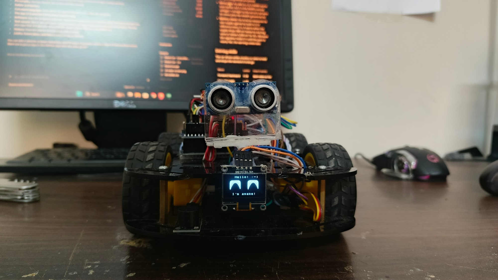
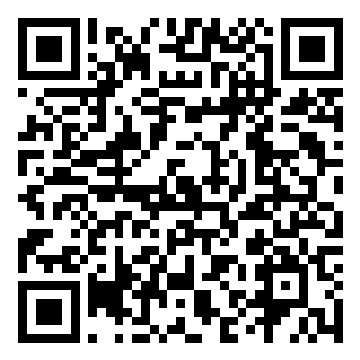
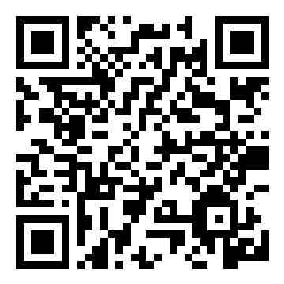

# Robot Car (Arduino UNO)

A 4-wheel-drive Arduino robot car you drive from your phone with its own app. It stops before it hits
things, searches for open space by itself, does donuts, curves, turbo bursts and "chaos" mode, shows
eyes on a little OLED screen, and **dances to 39 songs** in time with the music while the buzzer plays
along. Every song has its own **choreography**: signature moves, and a routine for each part of the song
that comes back every time that part does, with poses on the phrase ends and full spins that finish
facing the front.

**The car's CV - every detail in one page: [Docs/ROBOT_CAR_CV.md](Docs/ROBOT_CAR_CV.md)** (also as a [PDF](Docs/Robot_Car_CV.pdf)).

**Everything the car and app can do, in one guide: [Docs/CAR_AND_APP_GUIDE.md](Docs/CAR_AND_APP_GUIDE.md)** (also as a [PDF](Docs/Robot_Car_Guide.pdf)).

And it has **play modes**: **follow me**, **goalkeeper** (with a kick), **guard** (an alarm that tells
your phone), **music** (your hand plays notes), **gestures** and a little **robot pet** - plus a **radar** that maps the room on its screen and in the app.

## 📱 The app

**[⬇ Download the Robot Car app](https://github.com/mayaanmalik2486/robot-car/raw/main/App/RobotCar.apk)**
(Android, version 4.2). Send that link to anyone. How to install and connect: [App/README.md](App/README.md). It looks and feels like a game controller, shows a live 3D car, steers smoothly with a real steering wheel and throttle lever (or one stick, or tilt), and is mapped to the **GameSir Cyclone 2** - both sticks, both triggers, every button, all changeable, with a live drawing of the controller.

**On a computer?** The same remote runs in Chrome or Edge: [Web/README.md](Web/README.md) (open `Web/index.html`) - with the mouse, the keyboard or the controller.

| Scan to download the app | Scan to open this page |
| :---: | :---: |
|  |  |

More QR codes (app guide, CV, full guide, song list) are in [Docs/qr](Docs/qr).

## What's in this repo

| Folder | What it is |
|---|---|
| [`Robot_Car_Main`](Robot_Car_Main) | **The main robot program** (latest version). Upload this one for normal use. Also has the full [wiring and power guide](Robot_Car_Main/POWER_AND_WIRING.md). |
| [`Dances`](Dances) | 39 copies of the main program, each with the choreography for one song. The [song list, what each dance does, and how to dance in time](Dances/README.md) are in that folder. |
| [`Docs`](Docs) | The car's CV and the full guide (pages + PDFs), photos and QR codes. |
| [`App`](App) | The phone app (`RobotCar.apk`), its code and its tests. |
| [`Web`](Web) | The same remote as a web page, for computers (Chrome / Edge). |
| [`IR_Remote_Addon`](IR_Remote_Addon) | Want the IR remote back? One file + 3 lines, with a guide. |
| [`UPDATE_ALL_SONGS.bat`](UPDATE_ALL_SONGS.bat) | Changed `Robot_Car_Main`? Double-click this: every song file gets your change (each keeps its own song and choreography), then it checks they all compile. |
| [`Dances_Before_Choreography`](Dances_Before_Choreography) | All 39 song dances as they were before the choreography (the older dance style), with their song list. |
| [`Old_Versions`](Old_Versions) | Every earlier version of the main code, oldest first (from the starter tutorial and the first servo test up to v9). |
| [`IDEAS.md`](IDEAS.md) | What's been built, how it fits in the memory, and ideas saved for later. |
| [`Tools`](Tools) | Computer scripts that make the dances and test everything in a simulator. **You don't need these** to use the car. |

## How to put a program on the car

1. On this page, click the green **Code** button, then **Download ZIP**, and unzip it.
2. Open the `.ino` file you want in the **Arduino IDE** (for example `Robot_Car_Main/Robot_Car_Main.ino`).
3. The first time only, install the **U8g2** library (by oliver) in the IDE (**Tools > Manage Libraries**).
   Servo, SoftwareSerial and Wire come with the Arduino IDE.
4. Every program is already set to **Arduino Uno** on **COM4** (if your COM number is different, pick it
   in **Tools > Port**). Click **Upload**.

## Controls

The app has a button for each of these. (Any "Bluetooth RC car" app works too: these are the letters it must send.)

| Letter | Does | Letter | Does |
|---|---|---|---|
| F / B | forward / backward | L / R | spin left / right |
| G / H | curve left / right (forward while turning) | S | stop |
| Q / W | slow / full speed | T | turbo (a 1.5 s full-power burst) |
| Y | horn | 4 | dance (press again ON a beat to line it up) |
| 2 / J | auto forward / auto backward (stops at obstacles) | 3 | donut |
| U | 180-degree turn | u | smooth brake |
| 1 | chaos | I | search (looks around and drives to open space) |
| M | follow me | K / k | goalkeeper / kick! |
| A | guard (alarm) | N | music (your hand plays notes) |
| E | gestures (tap, double tap, hold close, hold further) | P | pet |
| O | radar (stands still, sweeps the sensor, draws a radar map) | | |
| X | mute / unmute every sound | V | football: the distance sensor off (it never stops for things). Search, chaos and the play modes still use it. |

**Smooth steering** (the Robot Car app 4.0 and the web remote): codes above 127 set the speed of each side of the car,
`128 + 64 x side + speed + 32` (side 0 = left, 1 = right; speed -31 ... 31, 0 = stop). The car still stops for walls, and
stops by itself if these codes stop coming for 0.6 s (phone out of range).
**Sensor head:** the codes 6 ... 26 point the servo (6 = 50 degrees right, 16 = straight ahead, 26 = 50 degrees left). Simple RC apps keep using the letters.

The car answers the app with a status line - `~MODE|1010`: what it is doing, then 1/0 for muted,
football, slow and low battery - plus `#S:` + its song name and `#V:3` ("I know steering and the head codes") when the app asks with `?`, and `#R:` radar dots. It also warns by itself when the battery is nearly empty.

## Parts and wiring

Arduino UNO + Sensor Shield V5, L298N motor driver, 4 DC motors, HC-05 Bluetooth,
SG90 servo with an HC-SR04 ultrasonic sensor, passive buzzer, SSD1306 OLED (and an IR receiver if you use the add-on).
Power: 3 x 18650 cells for the motors and Arduino (through the L298N's 5 V), plus 4 x AA for the servo.

| Part | Pins |
|---|---|
| L298N | ENA D5, ENB D6, IN1 D2, IN2 D4, IN3 D7, IN4 D10 |
| HC-05 | TXD to D3, RXD to A0 |
| Servo | D9 |
| HC-SR04 | TRIG D11, ECHO D12 |
| Buzzer | A1 |
| OLED (I2C) | SDA A4, SCL A5 |
| IR receiver (add-on only) | D8 |

Every wire, step by step: [POWER_AND_WIRING.md](Robot_Car_Main/POWER_AND_WIRING.md).
